---
tags:
  - 计算机网络
---

# TCP传输的底层原理

## 正式发送三个数据

>已经确认收到的数据可以从发送缓冲区清除，根据对方发来的rwnd实时调整发送窗口
>发送窗口值的单位是字节
>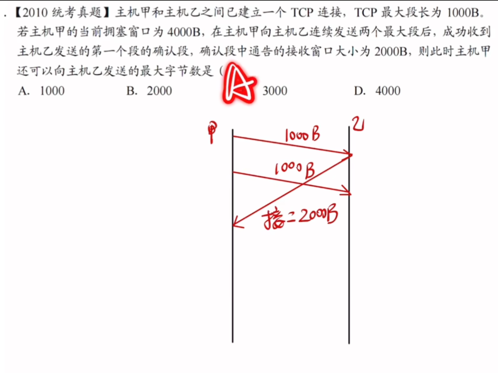
>甲收到确认后，发送窗口是2000没错，但是第二个发送出去的MSS还没有得到确认，所以它还留在发送窗口内，所以还可以发送的字节数就是1000
## 累积确认
连续发送两个报文段

>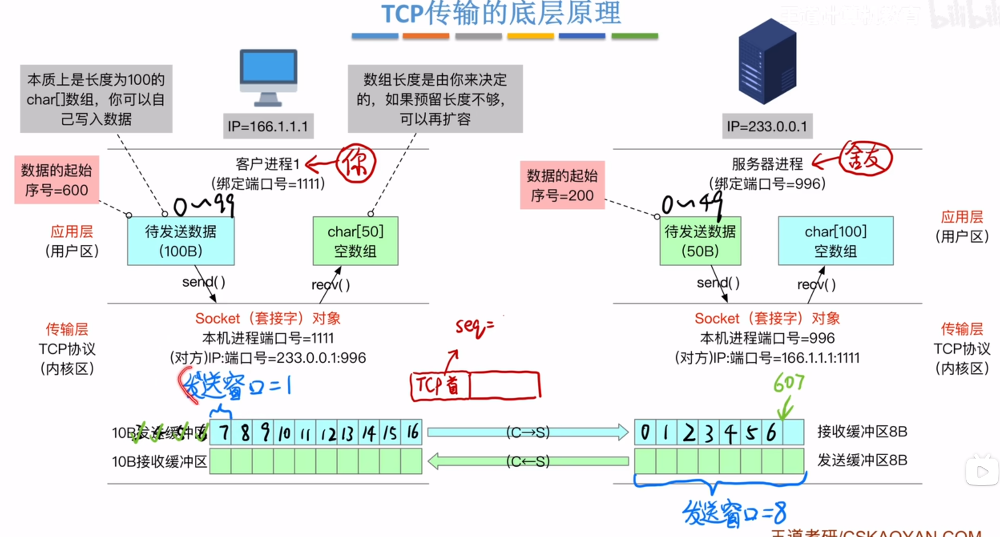

## 接收缓冲区满

>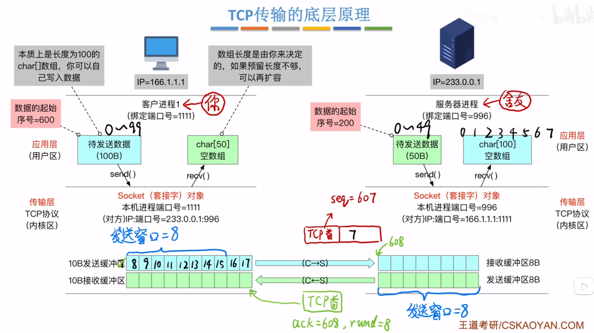

### 持续计时器
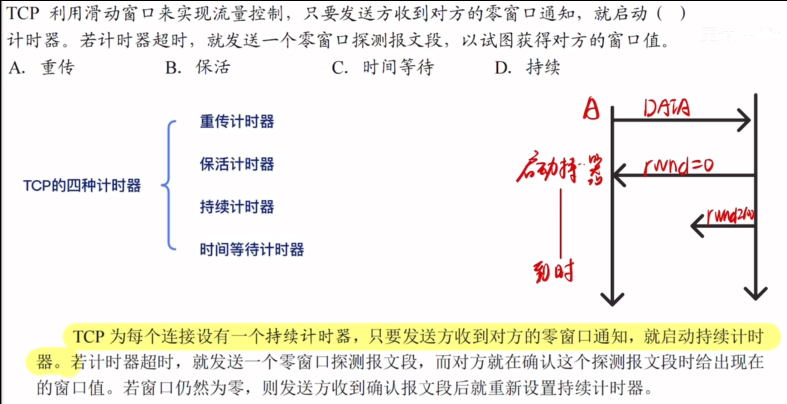
>p242,零窗口通知
## 捎带确认

>服务器返回ACK段时捎带上自己的数据

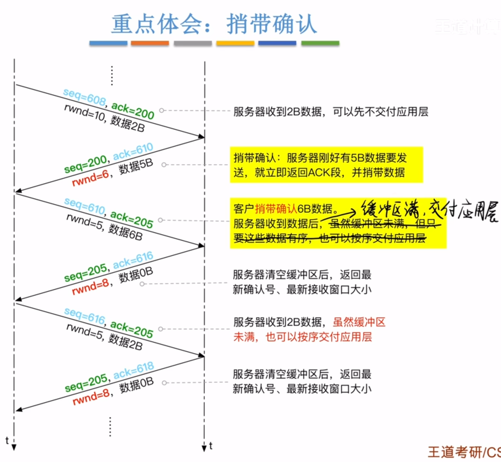
>现实应用中，接收缓冲区没满也可以交给应用层
>

## 超时重传机制
### 客户发出的报文段丢失

### 服务器返回的ACK段丢失

>服务器检查重传的seq，发现是622之前的，已经接收过，再次发出ACK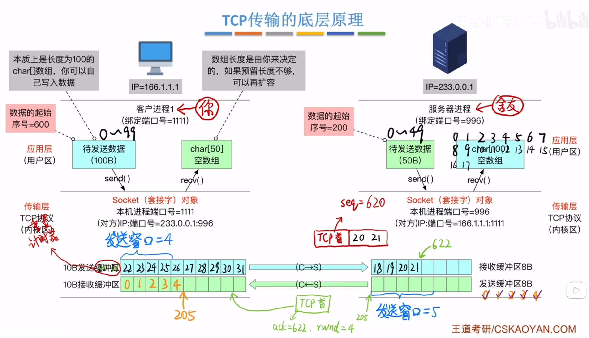

## 小结
### 可靠传输
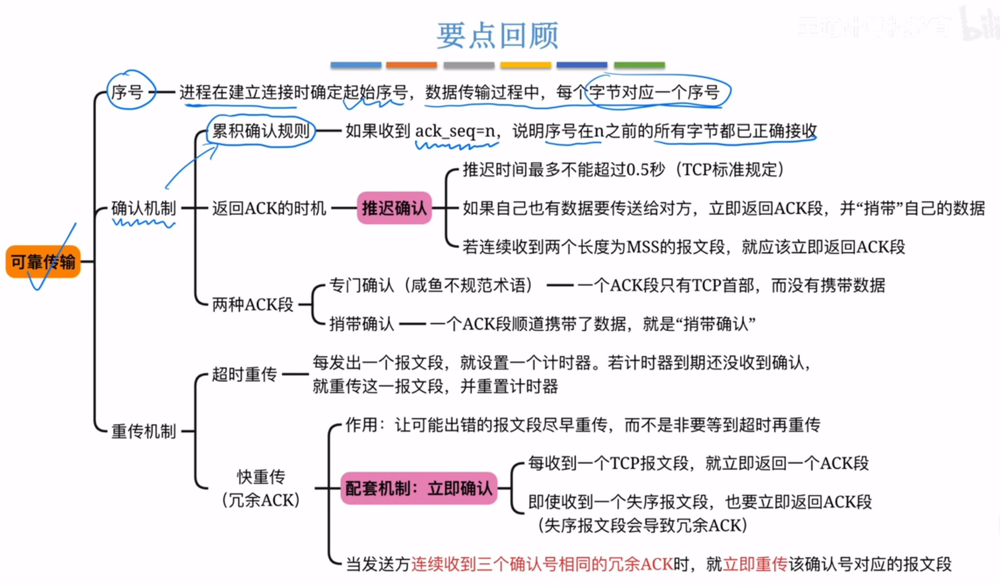

### 流量控制（滑动窗口）
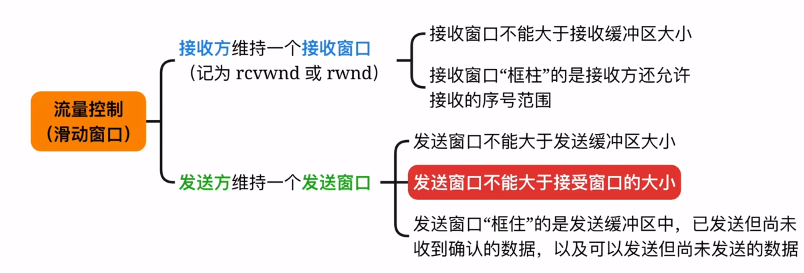

## 快重发机制
### 超时重传的问题

>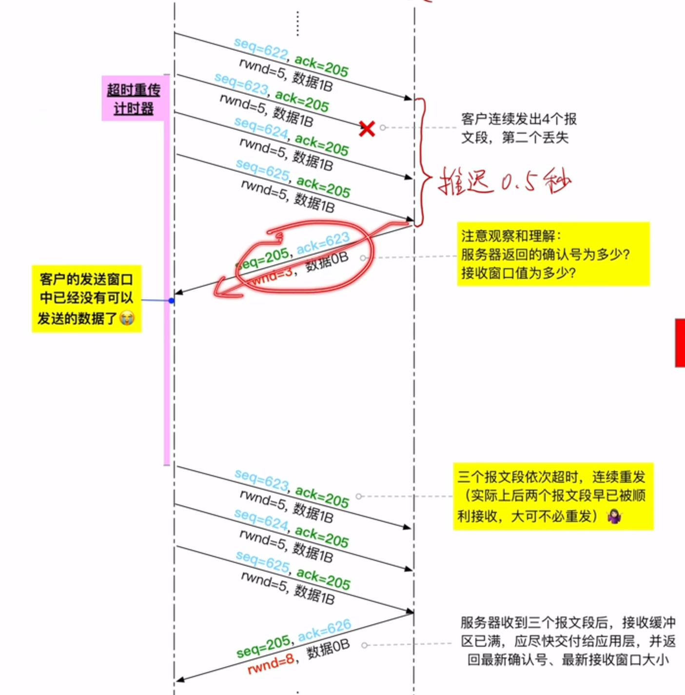
>客户还需要等待超时重传计时器才可以继续发送
>并且有些报文段是没有必要重传的

### 快重传

>采用立即确认的机制
>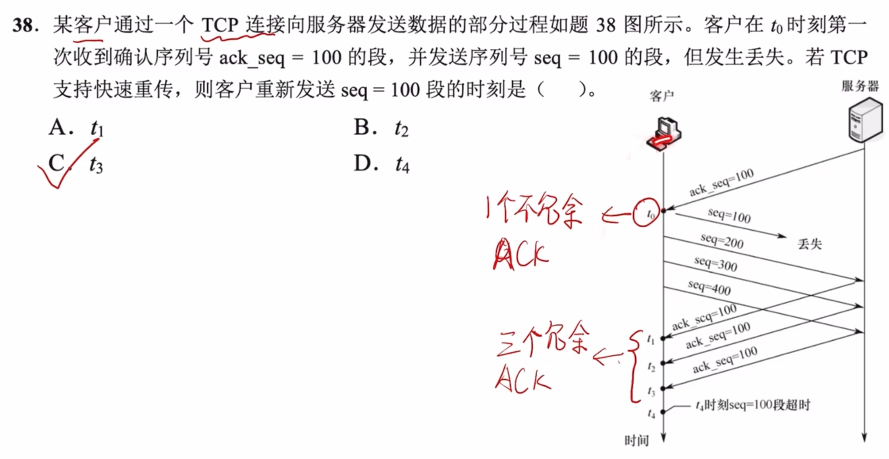
>

# 例题
## ack与客户还能发送多少的关系
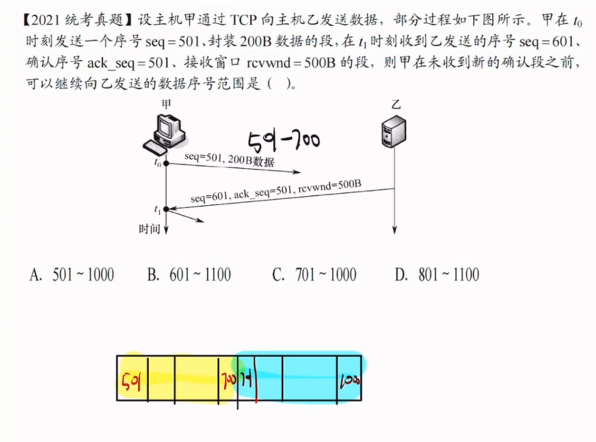
这是一个非常经典的 TCP 拥塞控制和流量控制结合的题目。我们来详细拆解一下为什么不能选 A，以及为什么选 C。

### 1. 理解 `ack_seq` 的含义

首先，我们来澄清一个常见的误区：

- **`ack_seq = 501` 的含义**：它表示接收方（主机乙）期望接收的下一个字节序号是 501。也就是说，乙已经成功接收了序号 500 及之前的所有数据，且**尚未收到序号 501 及之后的数据**。
- **这是否意味着甲可以立刻重发 501 或继续发 501？** 并不是。`ack_seq = 501` 在这里是一个**累积确认**，它告诉发送方（主机甲）：“我还没收到你的 501 号数据，所以请继续发 501 号数据”。

### 2. 分析甲在 $t_0$ 时刻的发送情况

- 在 $t_0$ 时刻，甲发送了一个段：`seq = 501`，封装了 `200B` 数据。
- 这意味着甲发送了序号从 **501 到 700** 的数据（因为 501 是第一个字节，200 个字节后，最后一个字节序号是 $501 + 200 - 1 = 700$）。
- 此时，这 200B 数据已经发送出去，但**尚未收到确认**。

### 3. 分析 $t_1$ 时刻收到的确认与窗口信息

在 $t_1$ 时刻，甲收到了乙发来的段，包含以下关键信息：

- **`seq = 601`**：这是乙发给甲的数据段的序号，与甲的发送无关，只是说明乙也在向甲发送数据。
- **`ack_seq = 501`**：乙期望接收甲的下一个字节序号是 501。这说明乙**还没有收到**甲发送的 501~700 这段数据（否则 `ack_seq` 至少会跳到 701）。
- **`rcvwnd = 500B`**：这是乙告诉甲的**接收窗口大小**。表示乙当前的接收缓冲区还有 500B 的空间，允许甲向乙发送最多 500B 的、尚未被确认的数据。

### 4. 计算甲的发送窗口与可发送范围

TCP 的发送方维护一个**发送窗口**，它的大小受限于接收方的 `rcvwnd` 和自身的拥塞窗口。在未收到新确认之前，我们主要看 `rcvwnd`。

- **乙的接收窗口范围**： 乙告知 `rcvwnd = 500B`，且 `ack_seq = 501`（即乙期望接收的起始序号是 501）。 这意味着，乙允许甲发送的数据序号范围是：从 501 开始，连续 500 个字节。 即乙的接收窗口覆盖的序号范围是：**501 ~ 1000**（$501 + 500 - 1 = 1000$）。
    
- **甲的发送状态**： 甲已经发送了序号 **501 ~ 700** 的数据（共 200B）。 这 200B 数据已经占用了乙接收窗口（501 ~ 1000）的前半部分。 因为甲**尚未收到**对这 200B 数据的确认（`ack_seq` 依然是 501），所以这 200B 数据仍然在甲的“已发送但未确认”状态，它们**依然占用着乙的接收窗口空间**。
    
- **甲还可以发送多少数据？** 乙的总接收窗口是 500B。 甲已经发送并占用窗口空间的数据是 200B（501 ~ 700）。 那么，甲**还可以继续发送**的数据量 = 总窗口大小 - 已发送未确认的数据量 = $500B - 200B = 300B$。
    
- **确定可发送的序号范围**： 甲接下来可以发送的数据，必须紧跟在已发送数据的后面，也就是从序号 **701** 开始。 甲还可以发送 300B 的数据，所以序号范围是： 从 701 开始，往后数 300 个字节，即 $701 + 300 - 1 = 1000$。 因此，甲在未收到新的确认段之前，可以继续向乙发送的数据序号范围是 **701 ~ 1000**。
    

### 5. 为什么不能选 A (501 ~ 1000)？

- 选项 A 包含了 501 ~ 700 这一段。
- 但是，甲在 $t_0$ 时刻**已经发送过** 501 ~ 700 这一段了。
- 题目问的是“**可以继续**向乙发送的数据序号范围”。既然 501 ~ 700 已经发出去了（只是还没被确认），甲就不能重复发送这些已经发出的数据（除非发生重传，但重传的前提是超时或收到 3 个重复确认，题目并未提及，且通常“继续发送”指的是发送新数据）。
- 甲只能发送窗口内**尚未发送**的新数据，也就是 701 及以后的数据。

综上所述，正确答案是 **C. 701 ~ 1000**。