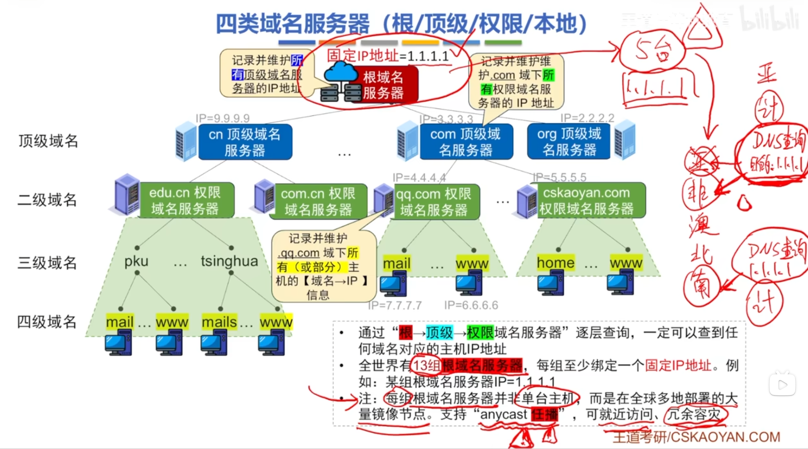
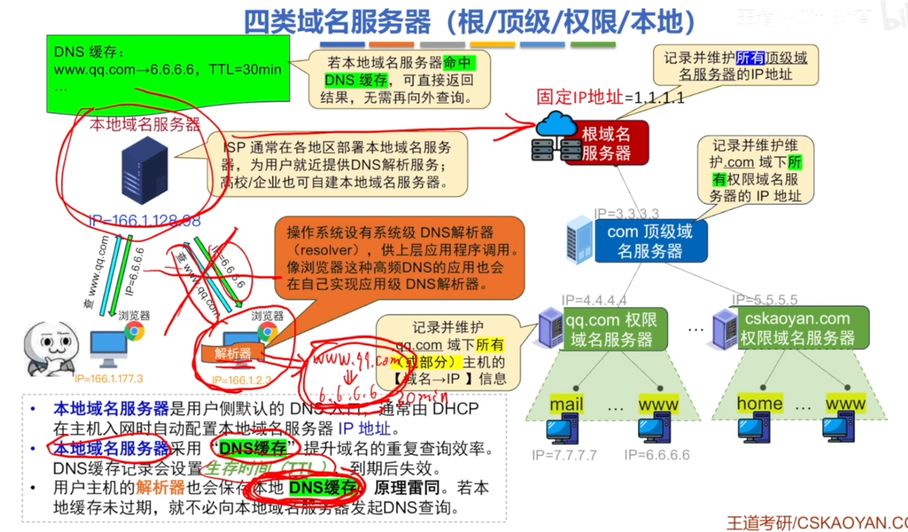
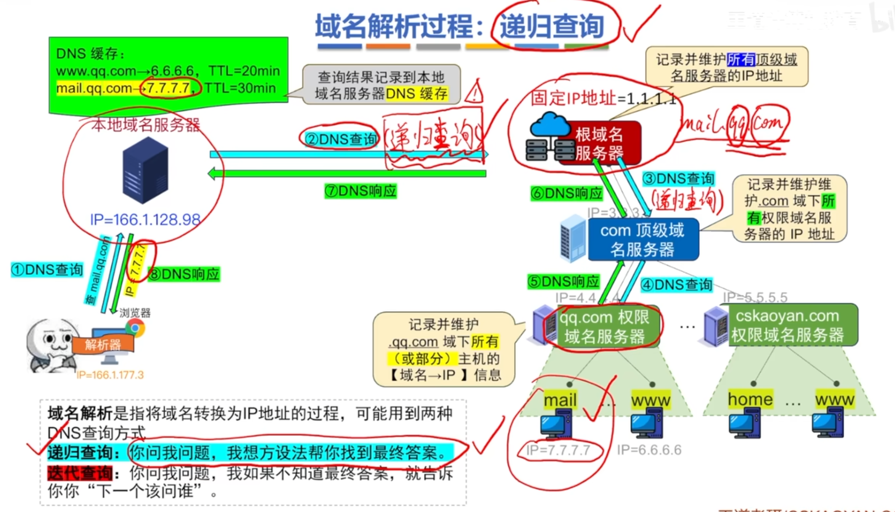
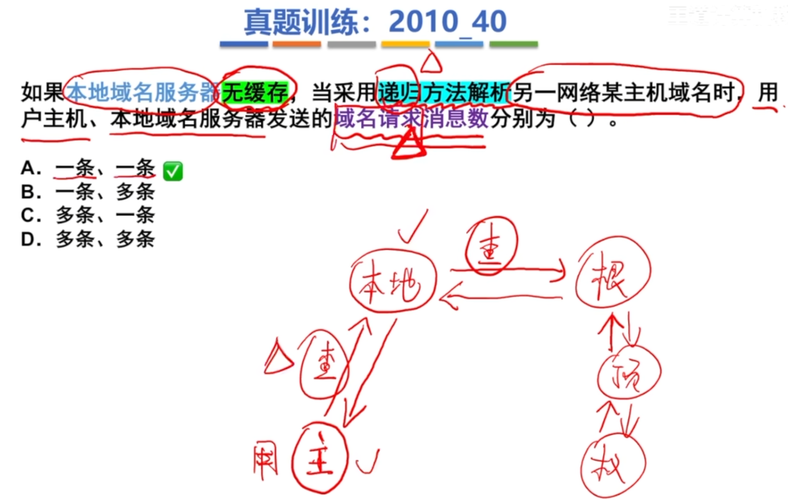
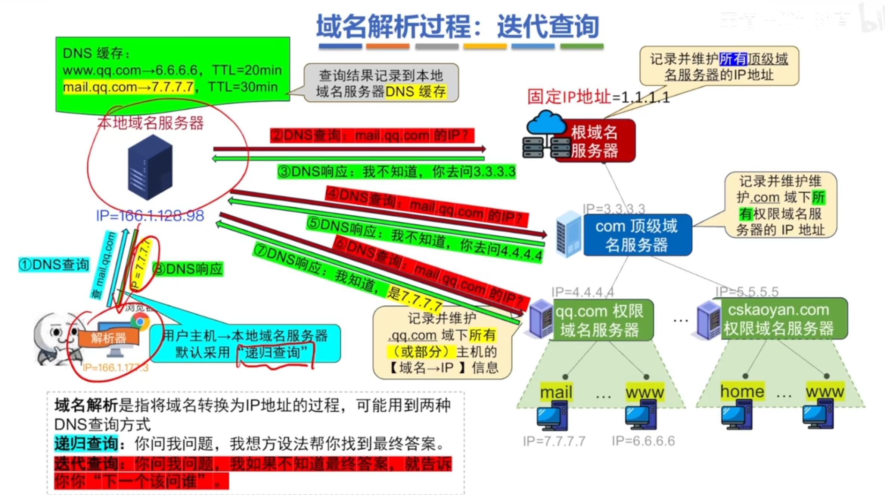
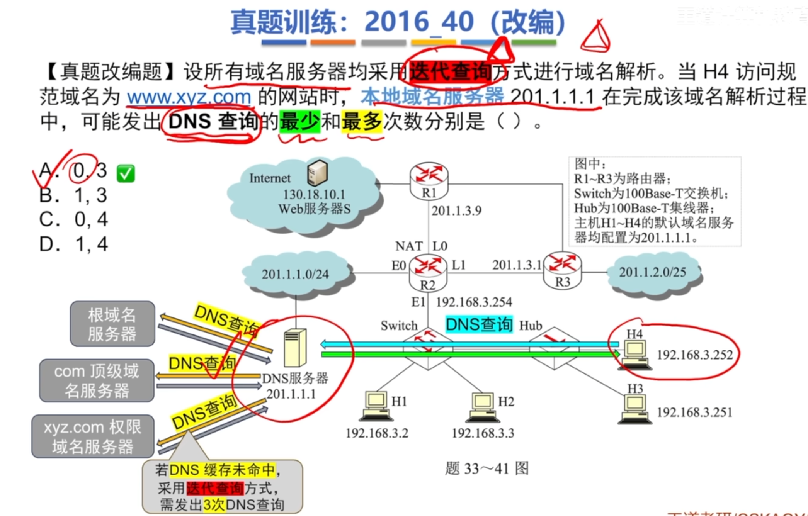

---
tags:
  - 计算机网络
---
# 概述

# 层次域名空间
## 书写规则

## 域名的层次结构

>一个域名可以对应多个IP地址，一个IP地址也可以对应多个域名
### 顶级域名（TLD）分类

### 小结

# 四类域名服务器

### 本地域名服务器

>本地域名服务器缓冲没命中的时候，会去查根域名服务器

# 域名解析过程
### 递归查询

>例题
>
### 迭代查询

>用户主机查本地域名服务器默认采用递归查询
>例题

