---
tags:
  - 计算机网络
---
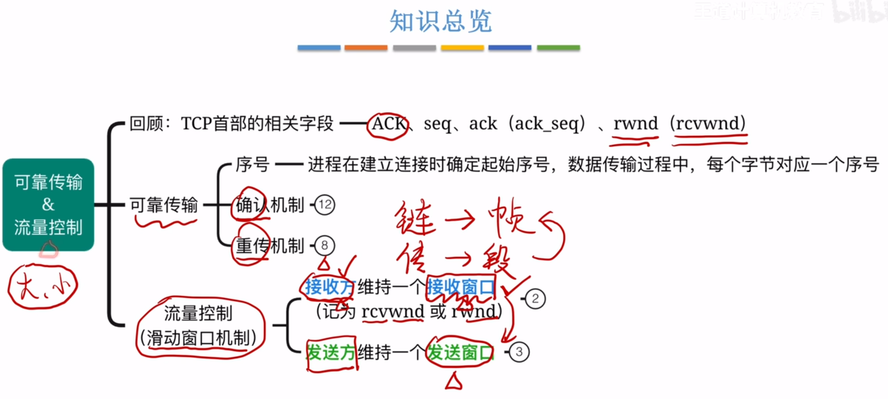

# TCP传输的底层原理
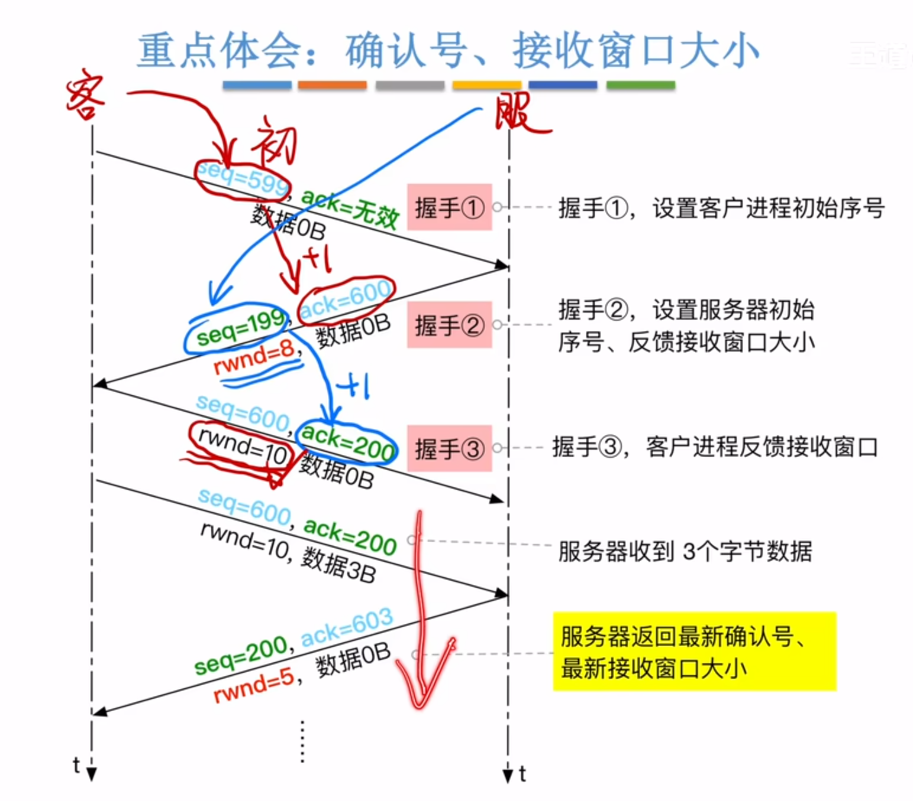

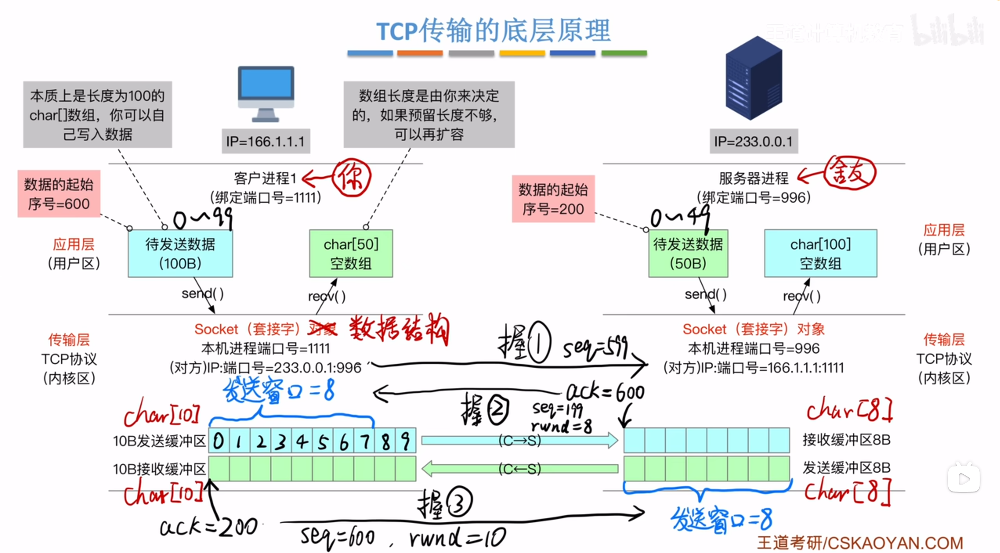

## 正式发送三个数据
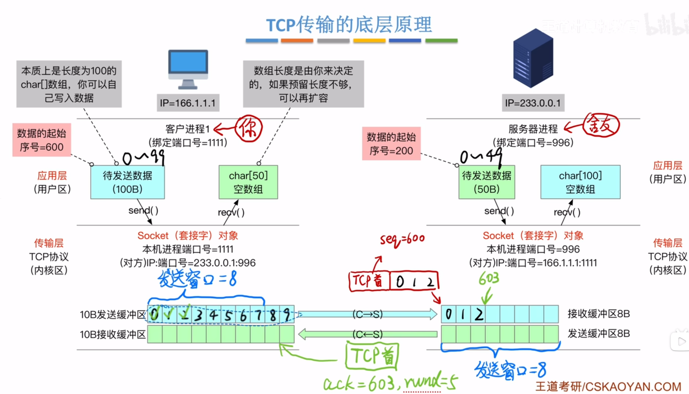
>已经确认收到的数据可以从发送缓冲区清除，根据对方发来的rwnd实时调整发送窗口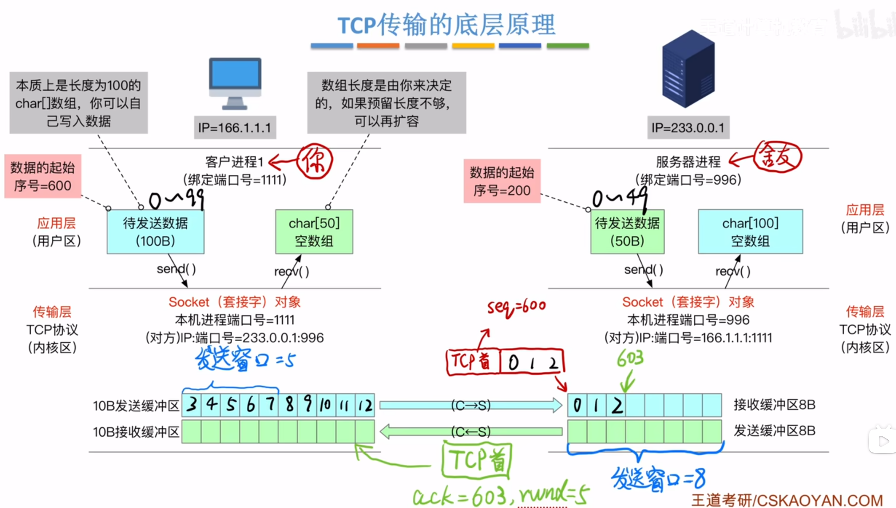
>发送窗口值的单位是字节
## 累积确认
连续发送两个报文段
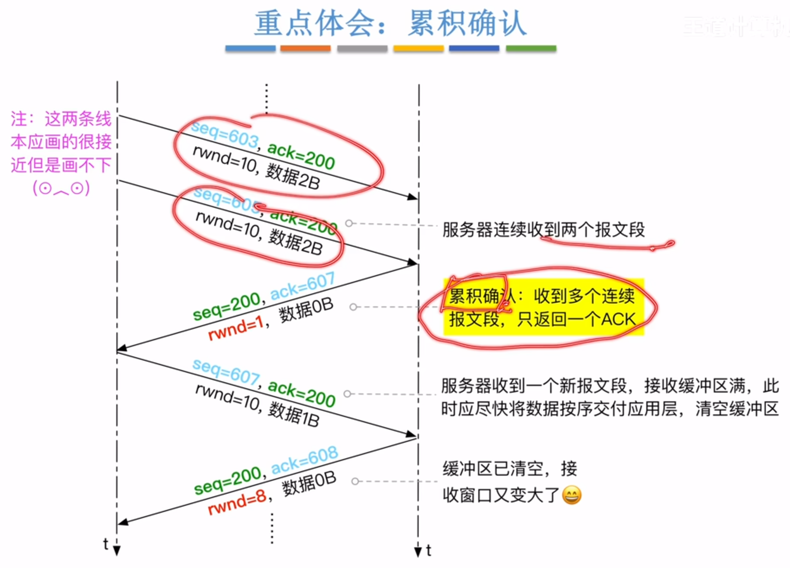
>

## 接收缓冲区满
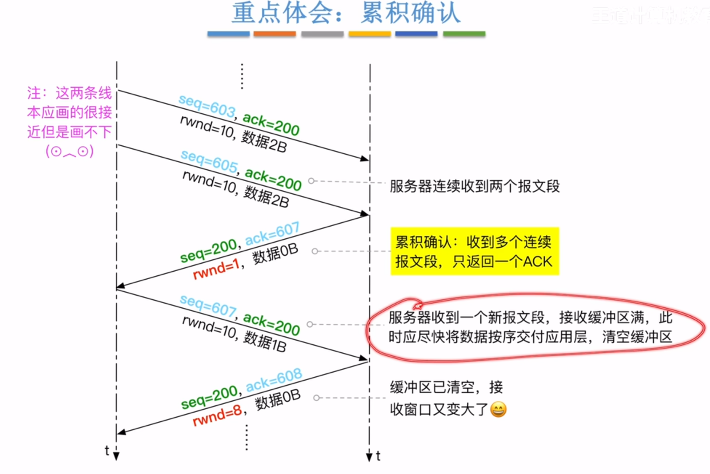
>

## 捎带确认
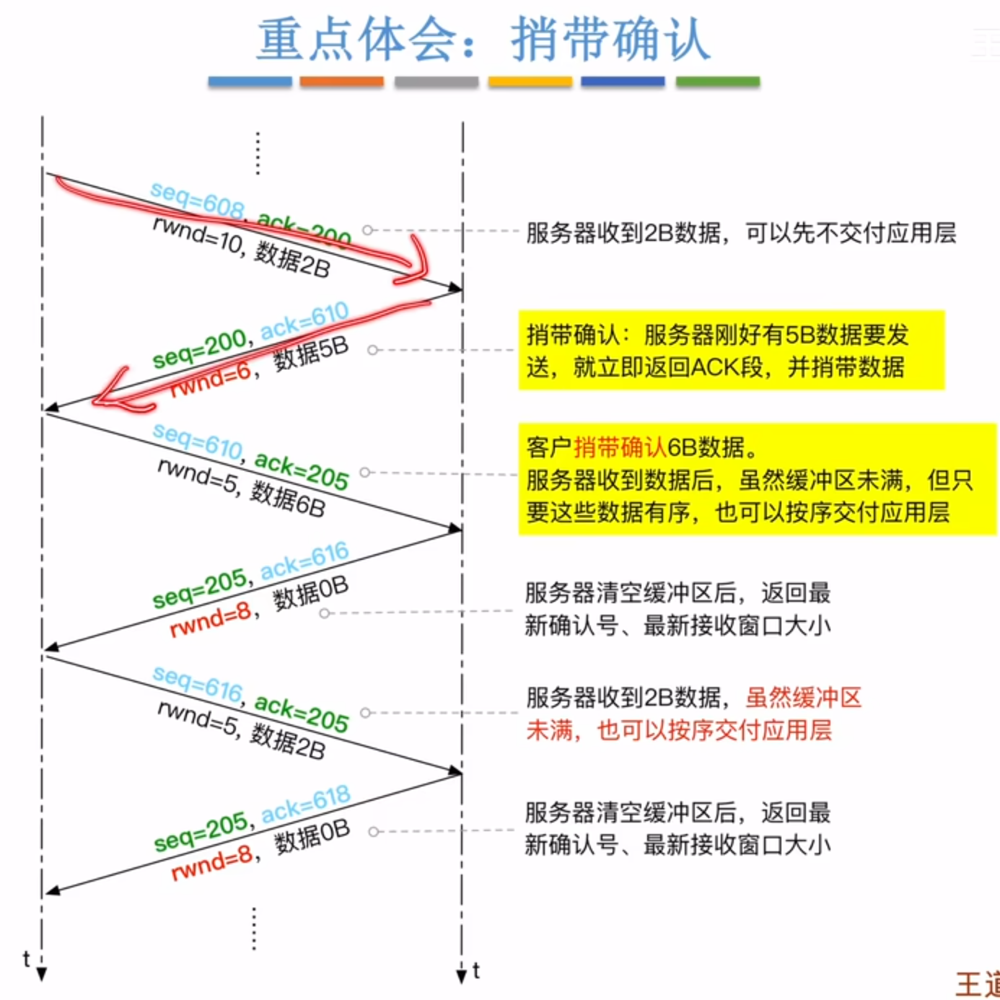
>服务器返回ACK段时捎带上自己的数据

>现实应用中，接收缓冲区没满也可以交给应用层
>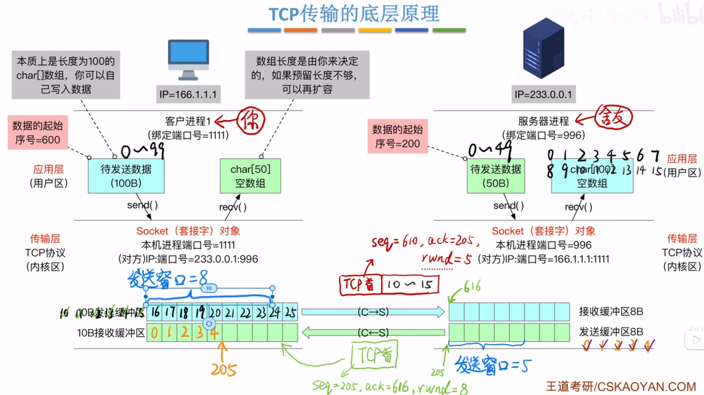

## 超时重传机制
### 客户发出的报文段丢失
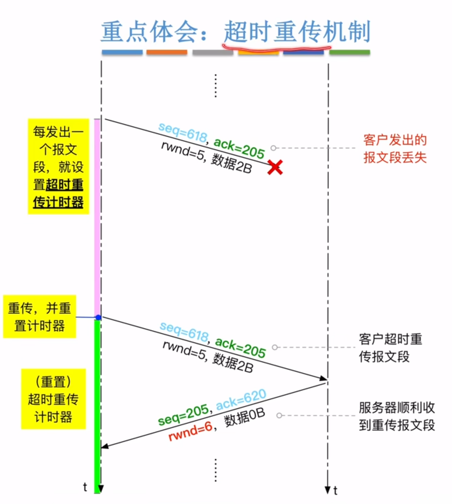

### 服务器返回的ACK段丢失
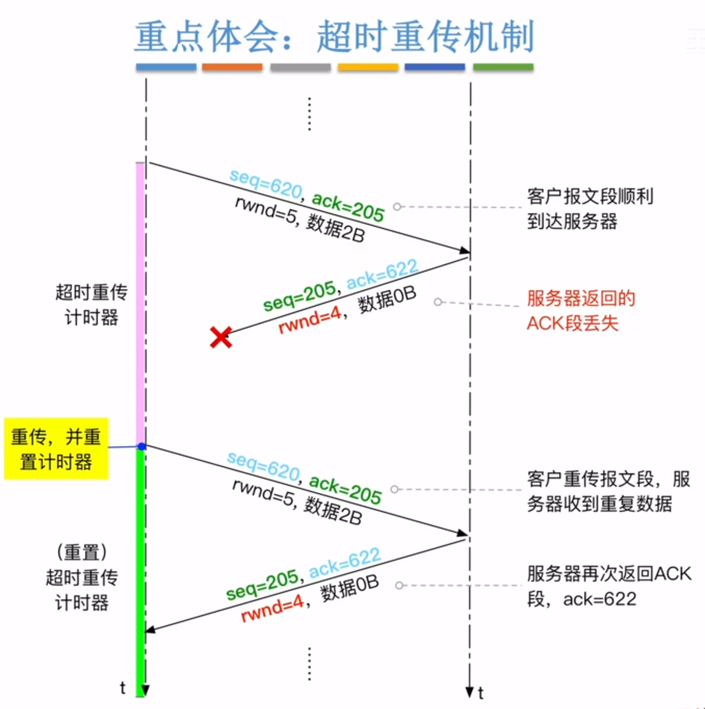
>服务器检查重传的seq，发现是622之前的，已经接收过，再次发出ACK

## 小结
### 可靠传输

### 流量控制（滑动窗口）

## 快重发机制
### 超时重传的问题

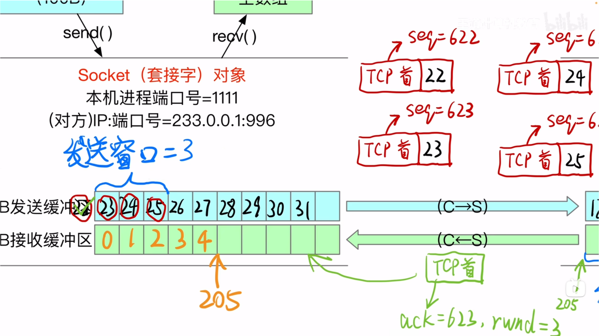
>
>客户还需要等待超时重传计时器才可以继续发送
>并且有些报文段是没有必要重传的

### 快重传
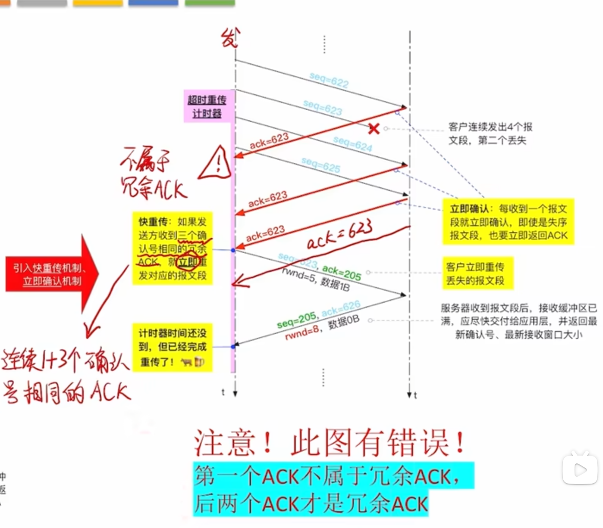
>采用立即确认的机制
>
>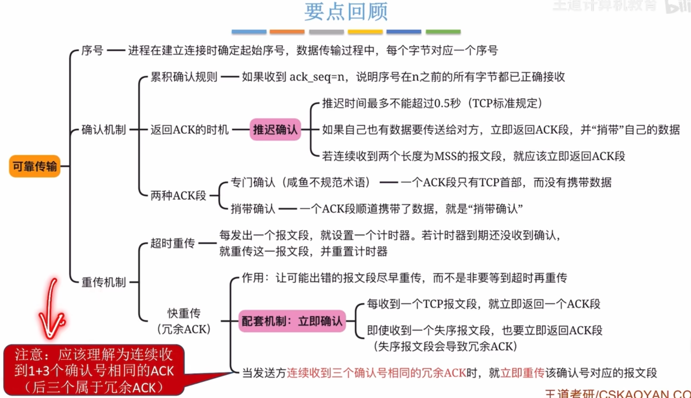