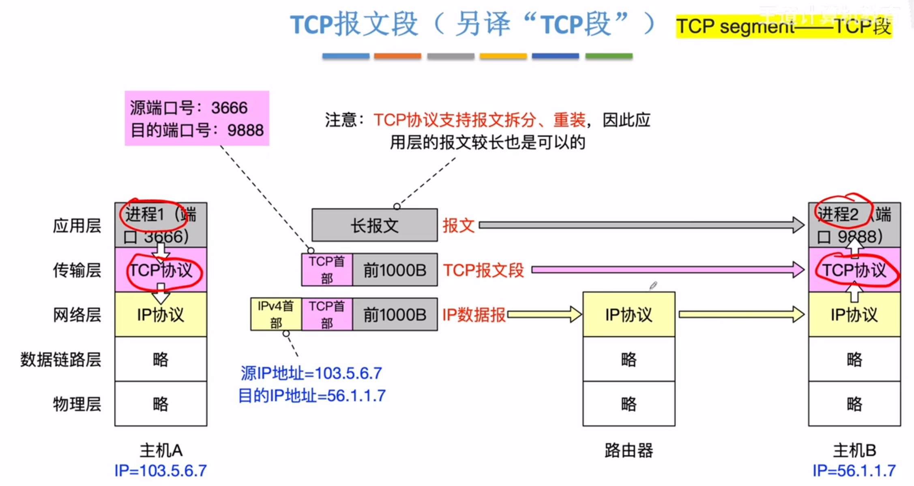
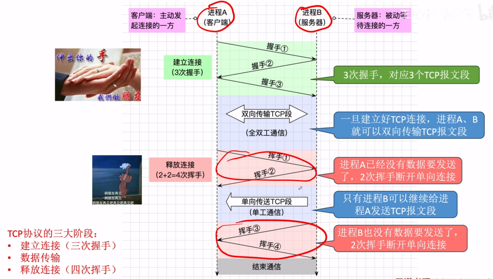
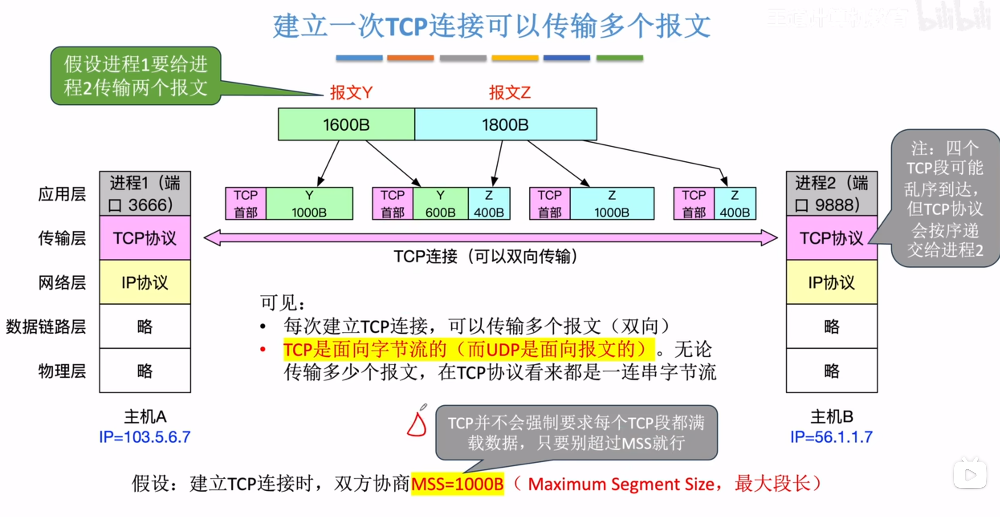
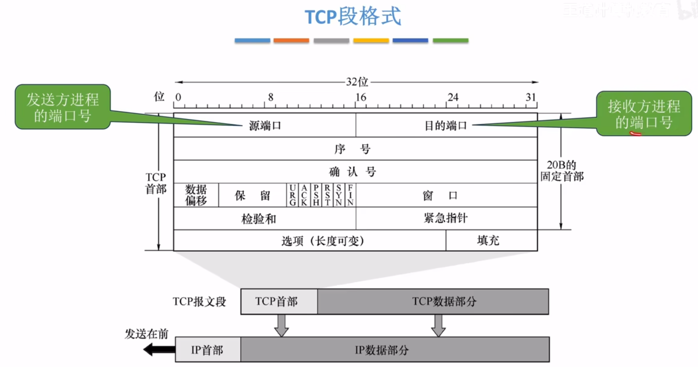
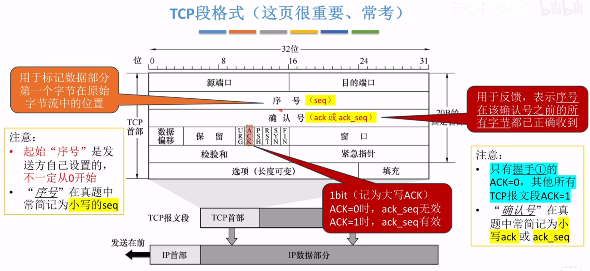
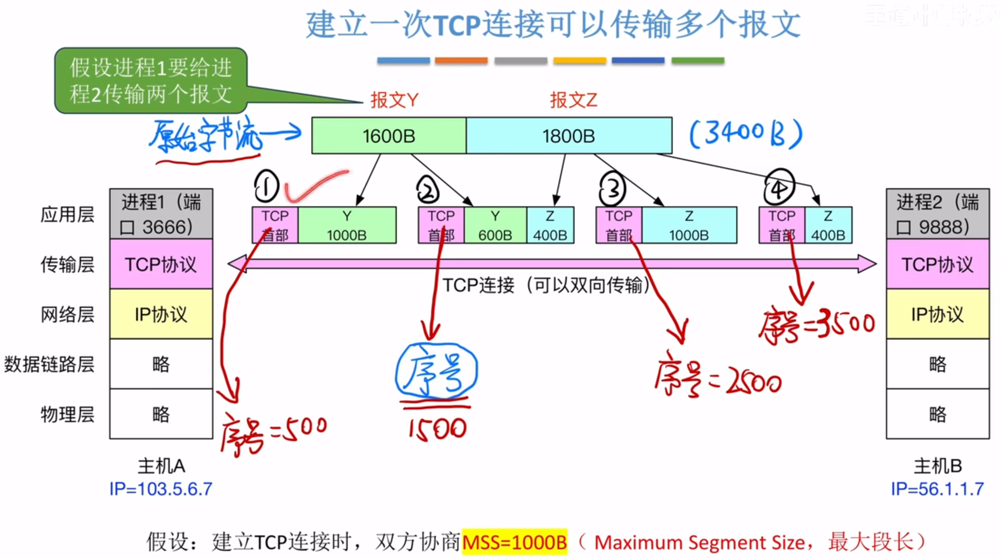
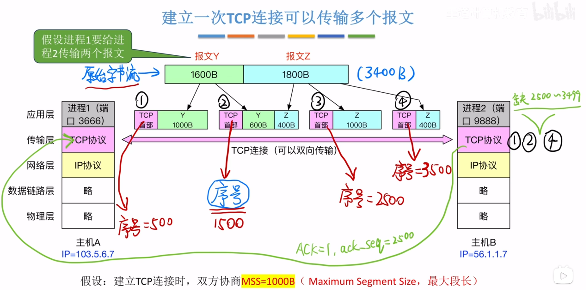

---
tags:
  - 计算机网络
---

# TCP协议的三大阶段

## 建立一次TCP连接可以传输多个报文

# TCP段格式

>序号作用：
>假设第一个TCP段设置序号为500，就表示这一串字节流的第一个字节的序号是500，序号这一栏就填500
>ack_seq作用
>返回ACK=1表示ack_seq有效，ack_seq=2500表示序号2500之前的所有字节都已收到，也就是确认了1号2号TCP段都收到了