---
tags:
  - 计算机网络
---

# TCP协议的三大阶段

## 建立一次TCP连接可以传输多个报文

# TCP段格式
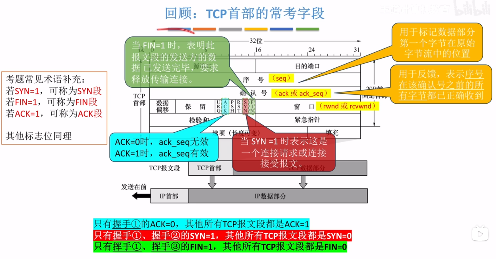

## 序号，确认号

>序号作用：
>假设第一个TCP段设置序号为500，就表示这一串字节流的第一个字节的序号是500，序号这一栏就填500
>ack_seq作用
>返回ACK=1表示ack_seq有效，ack_seq=2500表示序号2500之前的所有字节都已收到，也就是确认了1号2号TCP段都收到了

## 数据偏移，填充
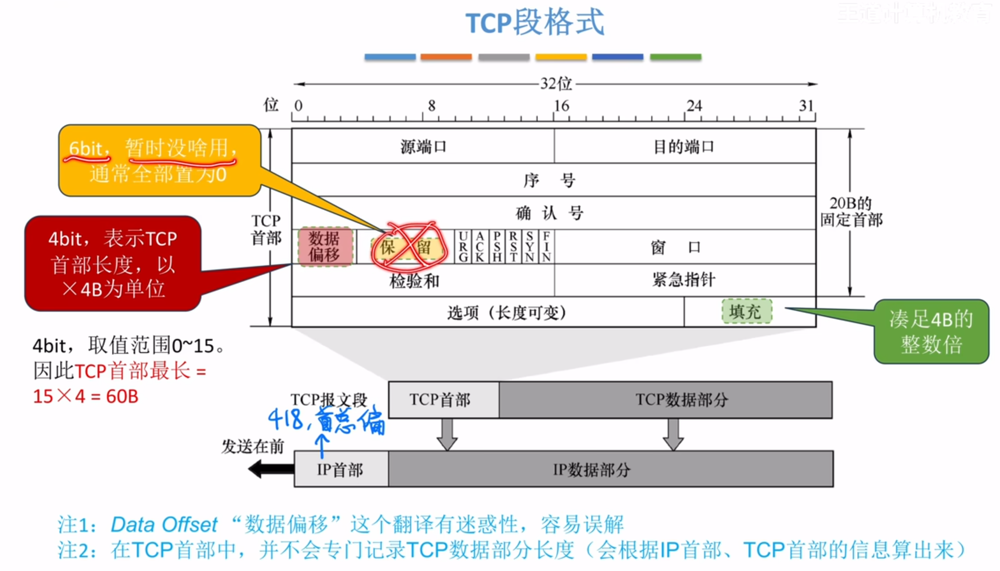
>数据偏移这项表示的是首部长度，以4B为单位，所以可以看到首部有一个填充项，就是为了凑4B的整数倍，TCP首部里没有记录总长度的项，因为知道IP数据报的总长度，然后可以通过IP总-IP首-TCP首得到TCP数据部分长度

## URG，PSH，RST
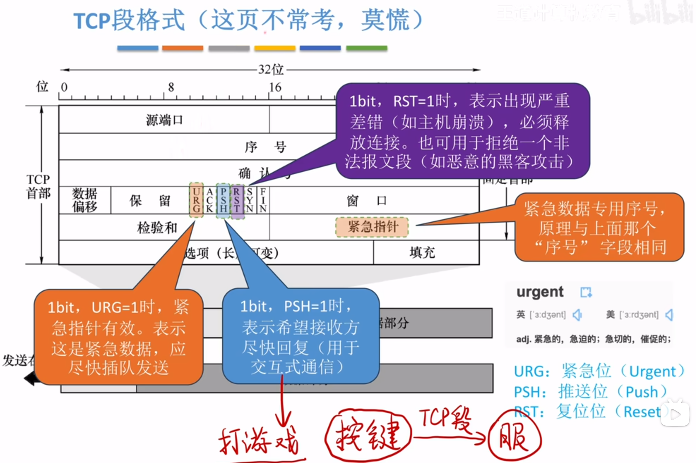

## SYN，FIN
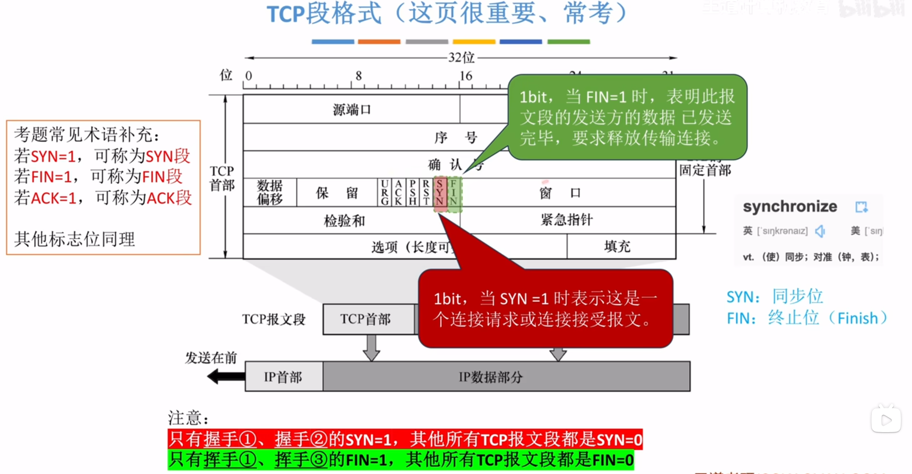
>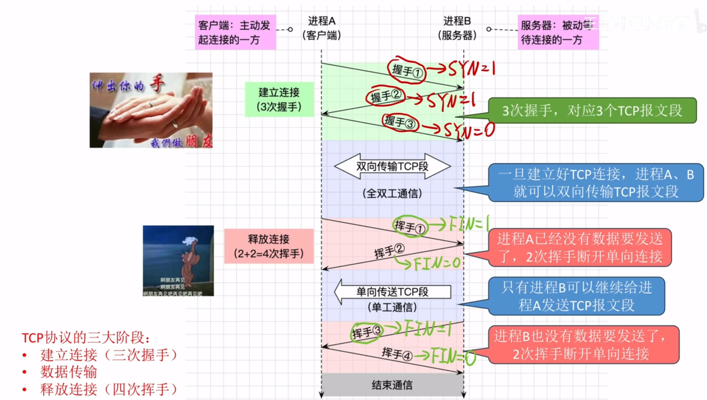

## 窗口
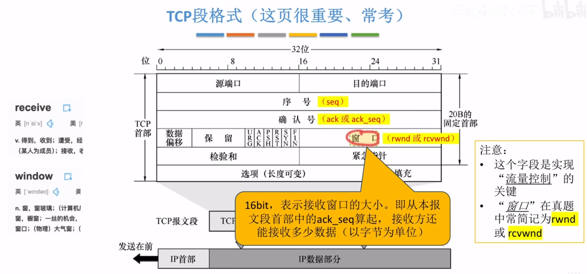
>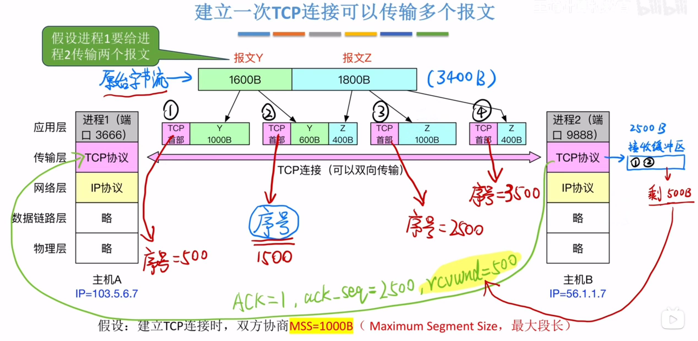
>rcvwnd=500表示还能接收500B数据

## 检验和
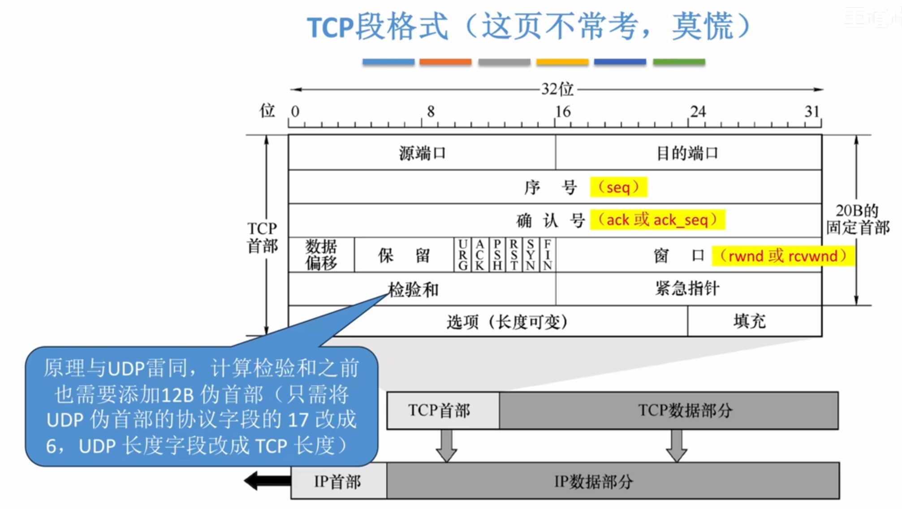
>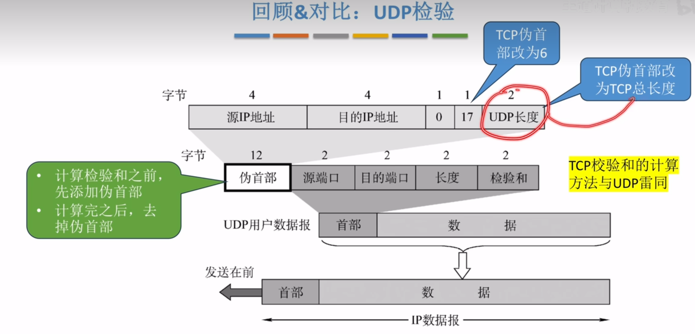

## 选项
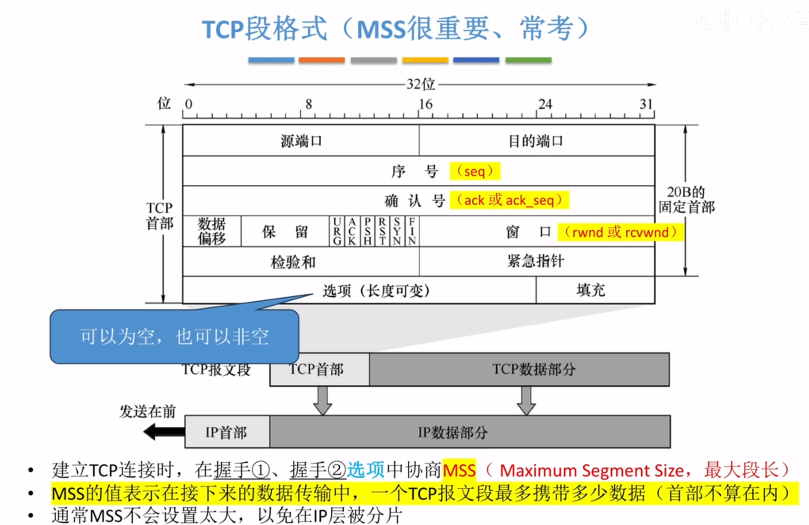
>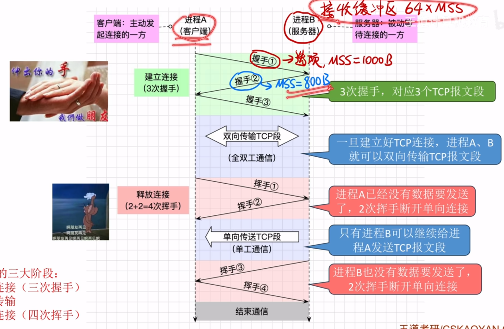
>两个进程之间的MSS可以不一样