---
tags:
  - 计算机网络
---
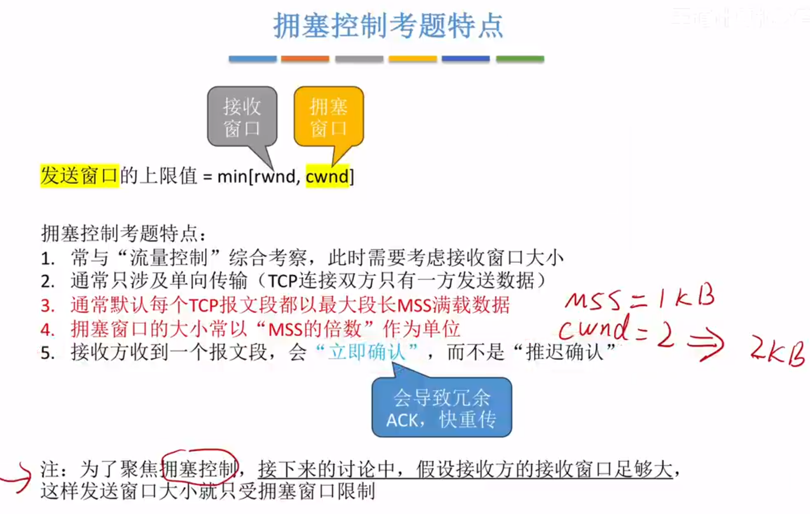
# TCP拥塞控制，TCP流量控制的区别与联系
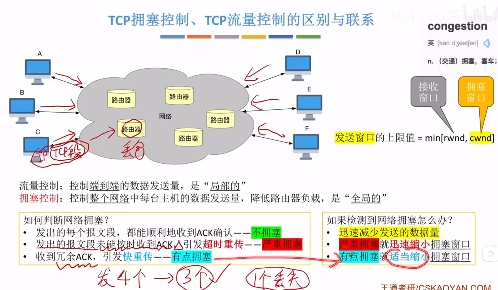
>拥塞控制的四种算法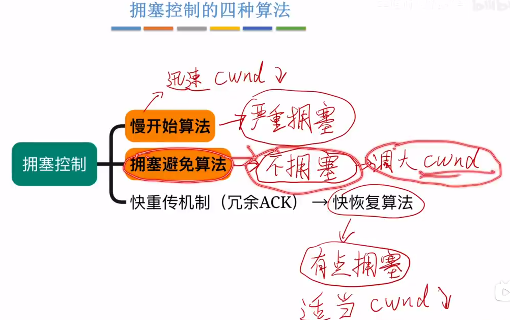

# 慢开始，拥塞避免
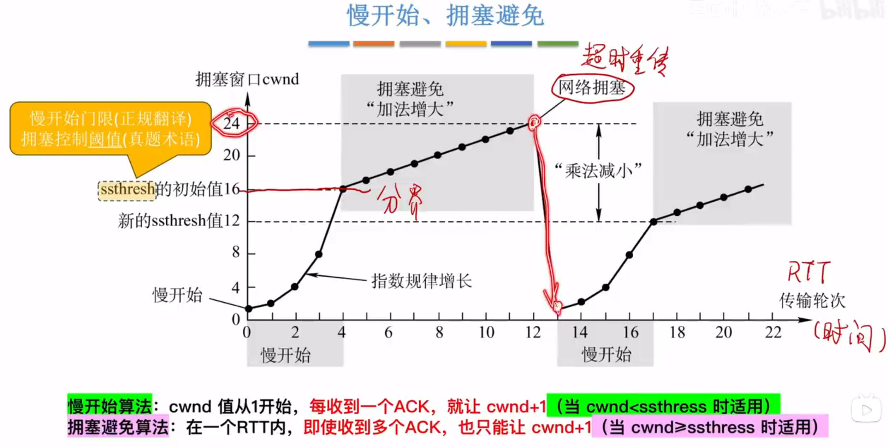
## 慢开始
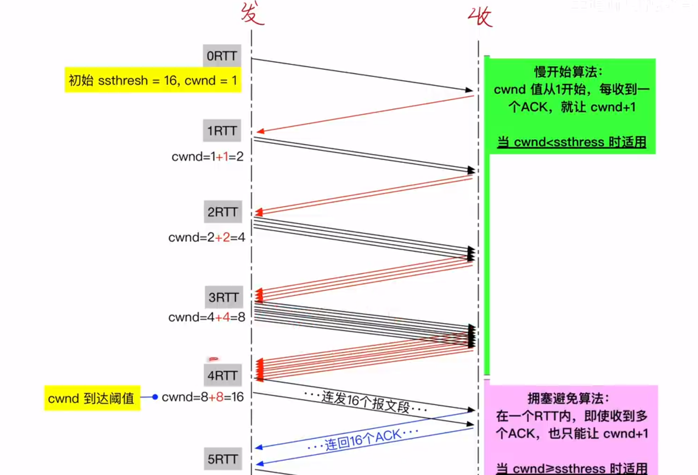
>cwnd从1开始
## 拥塞避免算法
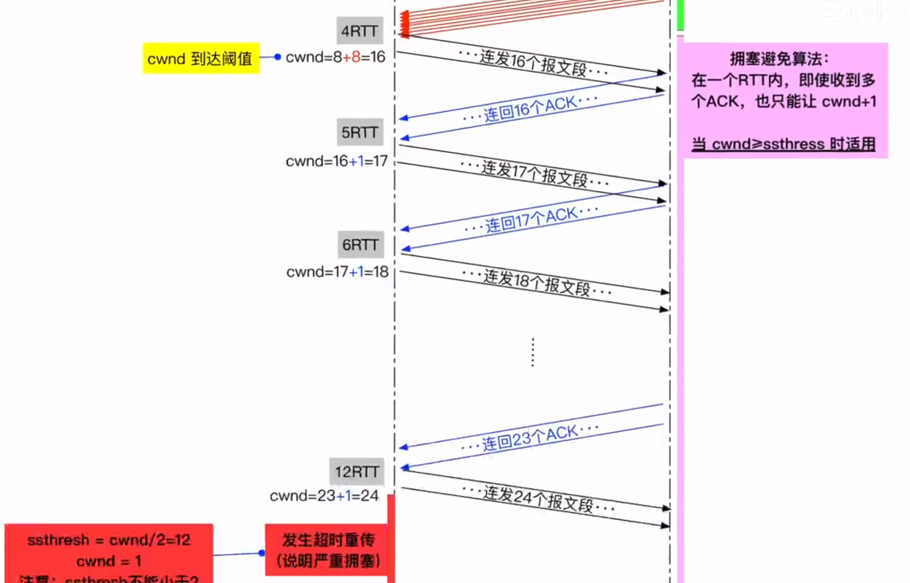

## 发生超时重传
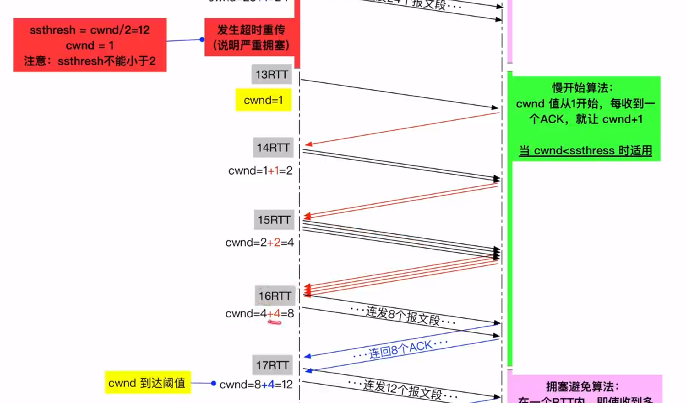
>新的ssthresh(拥塞控制阈值)为24/2，切换成慢开始算法，cwnd回到1
>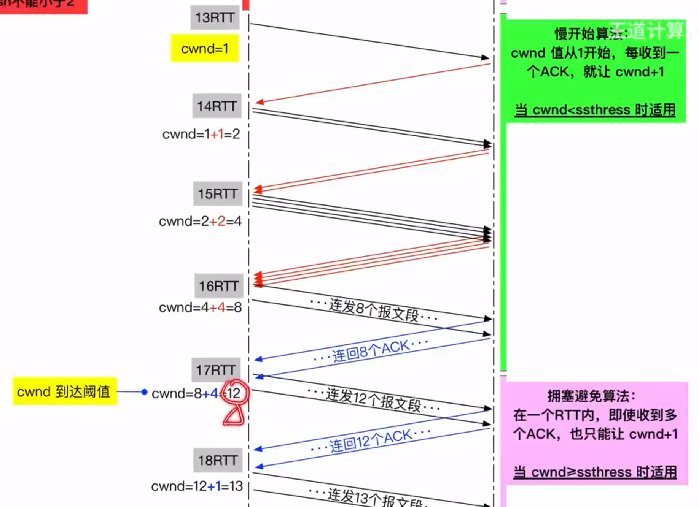
>慢开始算法的累积规则不能超过阈值的限定，8+4=12达到阈值而不是8+8

## 例题
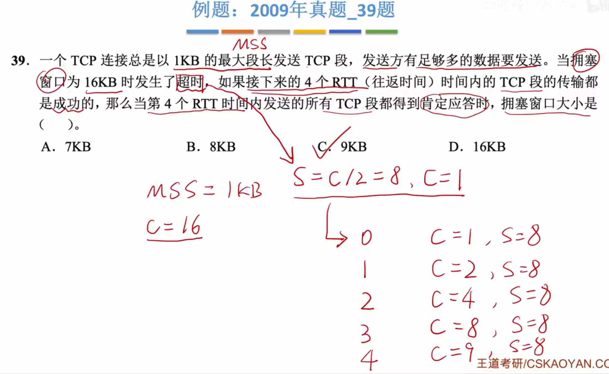
>S是阈值，等于16/2=8，c表示多少倍的MSS

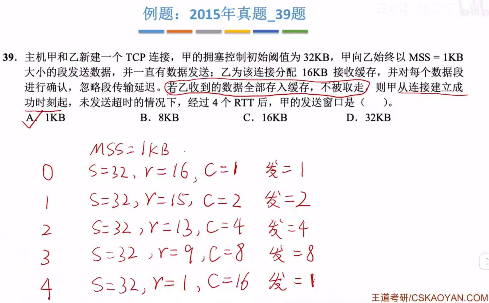
>阈值，接收窗口，拥塞窗口，发送窗口
>发送窗口是min(r,c)

# 快重传，快恢复
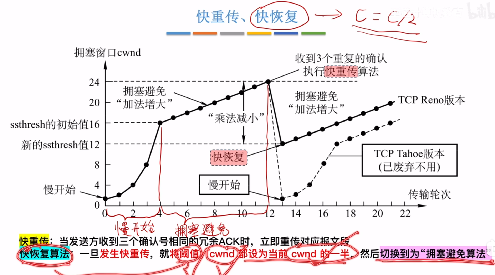

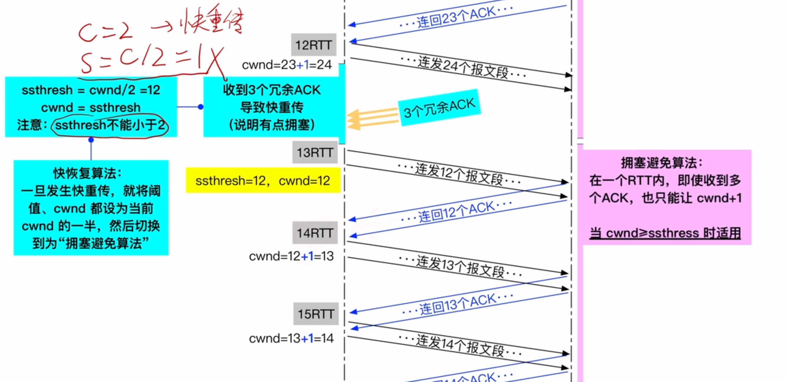