---
tags:
  - 计算机网络
---
# 建立连接（三次握手）
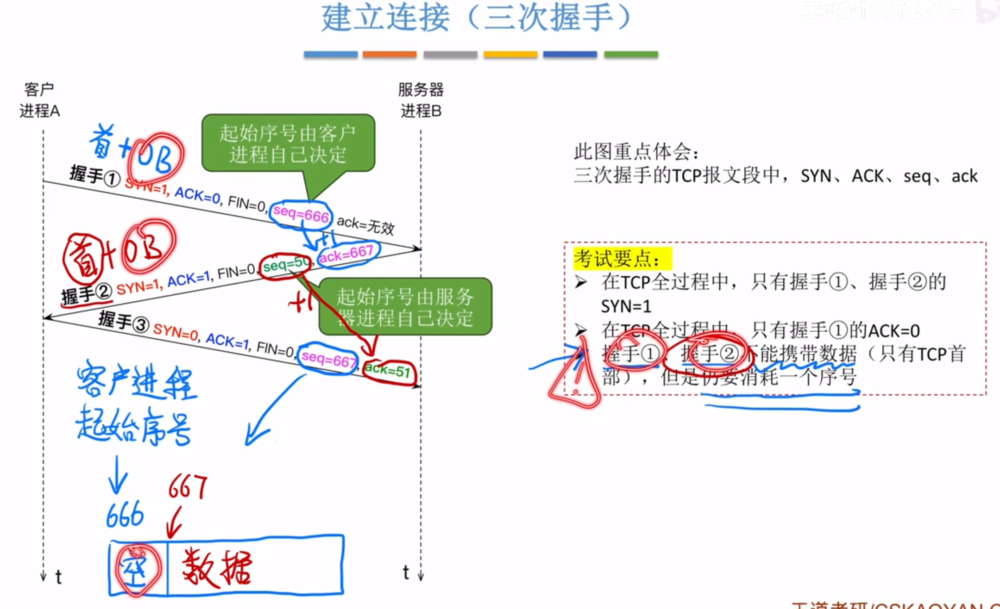
>有两个seq，分别是客户进程决定的和服务器进程决定的
>握手1,2是不携带数据的TCP报文

## 握手3
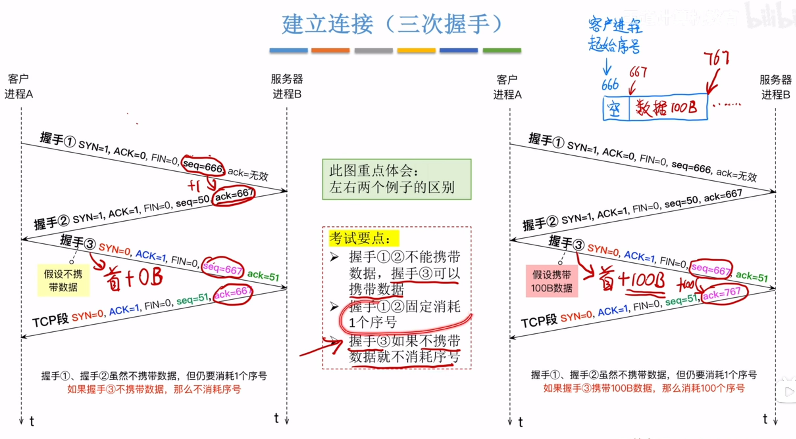
>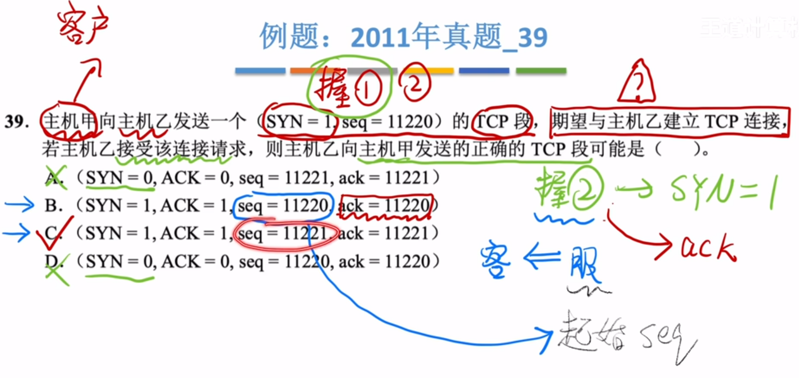

## TCP状态变化
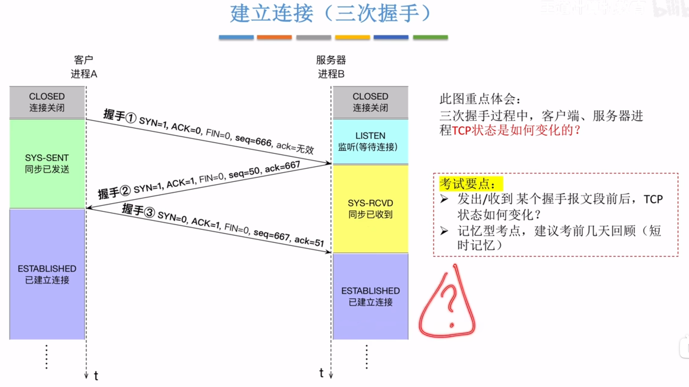

## 建立连接阶段耗时分析
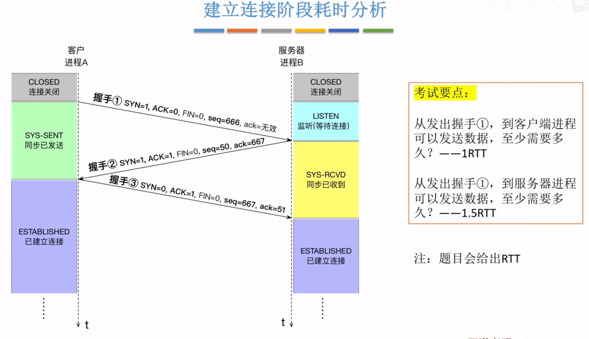

# 释放连接（四次挥手）
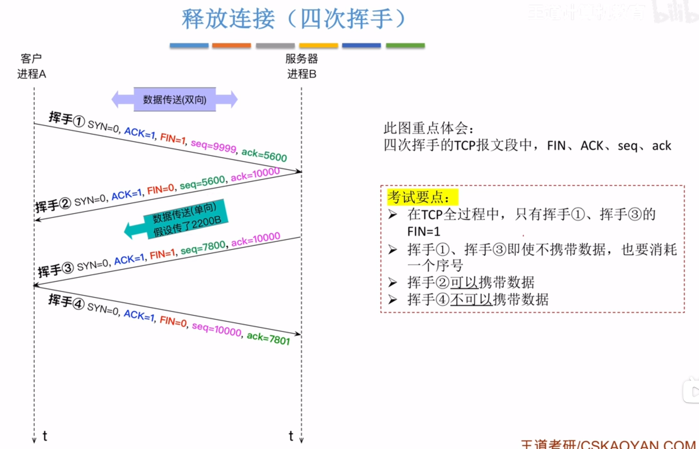
>挥手123是可以携带数据的

## 状态转换
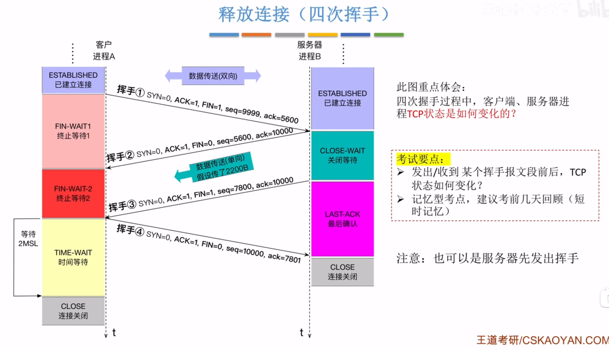
>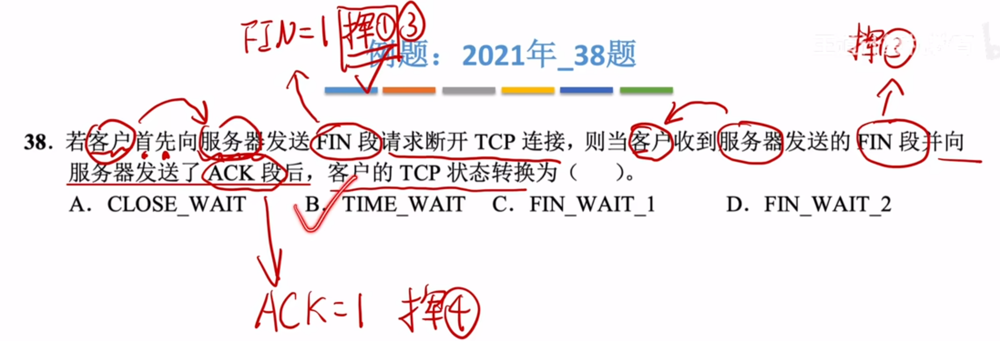
>客户的时间等待片段那里，有一个时间等待计时器p240
## 释放连接阶段耗时分析
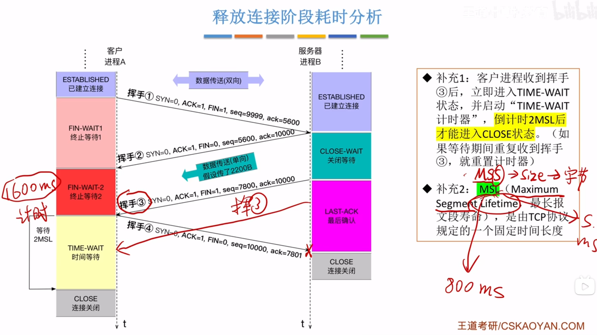

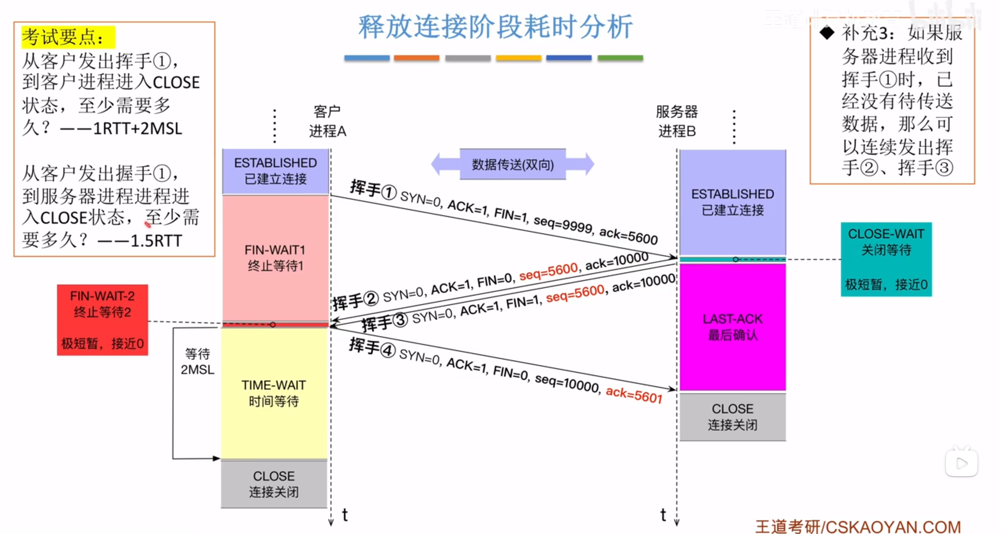
>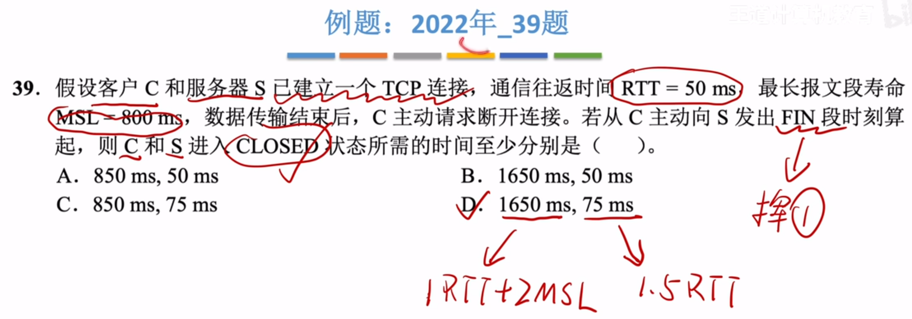

# 总结
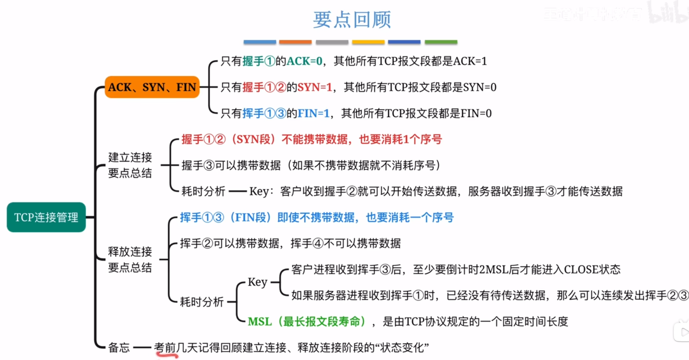

# 保活计时器
p240